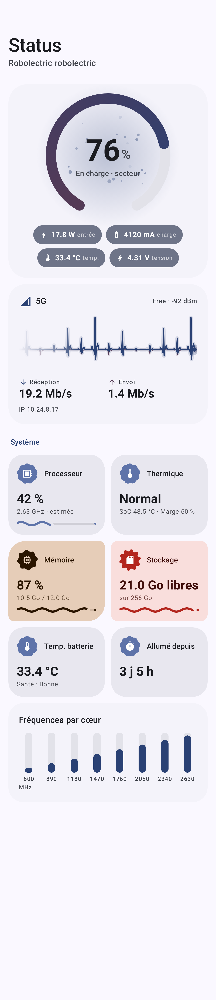
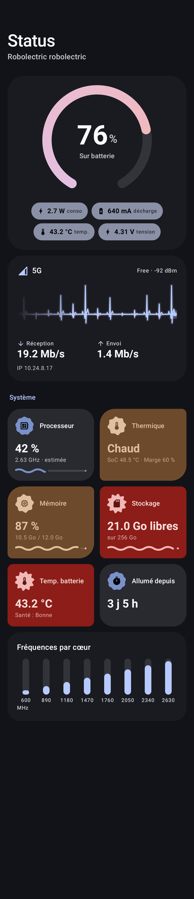
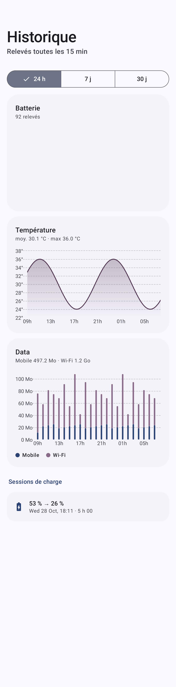
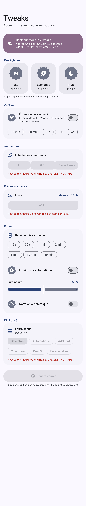

# Status

Status est un tableau de bord Android natif (Kotlin, Jetpack Compose, Material 3 Expressive) pour surveiller le téléphone en temps réel, avec des tweaks système intégrés.
Tout reste sur le téléphone : pas de serveur, pas de compte. Le seul appel réseau est la vérification des mises à jour sur GitHub.

| Tableau de bord | Sombre | Historique | Tweaks |
|---|---|---|---|
|  |  |  |  |

## Fonctionnalités

- **Live** :
  - Batterie : niveau, état, température, tension, courant et puissance en W. Le courant est normalisé selon l'appareil (mA ou µA, et le signe).
  - CPU (charge, fréquence de chaque cœur), statut thermique, RAM, stockage, uptime.
  - Réseau : débit en direct affiché comme un électrocardiogramme, type 4G/5G, signal en dBm, SSID du Wi-Fi et adresse IP.
- **Historique** : un relevé toutes les 15 min (WorkManager) et à chaque branchement ou débranchement. Données gardées 30 jours dans Room. Graphes sur 24 h, 7 j et 30 j pour la batterie, la température et la data.
- **Usage** :
  - Consommation mobile et Wi-Fi par appli.
  - Forfait configurable (300 Go et renouvellement le 1er par défaut), avec jauge et projection de fin de cycle.
  - Temps d'écran par appli, nombre de déverrouillages et graphe de la semaine.
- **Alertes** :
  - Seuil de charge (80 % par défaut), surchauffe (> 42 °C), stockage < 10 %, forfait à 80 % puis 95 %.
  - Son et vibration en `USAGE_ALARM`, qui passent outre le mode silencieux.
  - Notification persistante optionnelle avec les stats live.
- **Tweaks** :
  - Animations, fréquence d'écran forcée (clés AOSP, clés MagicOS détectées automatiquement, mesure de l'effet), délai de veille, luminosité, rotation, DNS privé et caféine.
  - Préréglages Jeu, Économie et Nuit, éditables, qui restaurent l'état précédent.
  - Nettoyage Honor (`pm disable-user`) et forcer l'arrêt (`am force-stop`).
  - Les valeurs d'origine sont toujours sauvegardées, et un bouton « Tout restaurer » les remet.
- **Tuiles Réglages rapides** : Caféine, DNS privé, Animations, Fréquence, Préréglage.
- **Widget Glance** : batterie, température et data restante. Il suit les couleurs dynamiques et se redimensionne.
- **Mise à jour in-app** : vérification au plus toutes les 6 h, changelog, téléchargement avec progression, installation via PackageInstaller.

## Étapes manuelles

### 1. Secrets GitHub (déjà en place)

Les secrets se règlent dans *Settings › Secrets and variables › Actions*, avec le **même keystore que Pilote** :

| Secret | Contenu |
|---|---|
| `KEYSTORE_BASE64` | Le fichier `.jks` encodé : `base64 -w0 pilote.jks` (Linux) ou `base64 -i pilote.jks` (macOS) |
| `KEYSTORE_PASSWORD` | Mot de passe du keystore |
| `KEY_ALIAS` | Alias de la clé |
| `KEY_PASSWORD` | Mot de passe de la clé |

Aucun fichier sensible n'est commité : `.gitignore` exclut `*.jks`, `*.keystore` et `keystore.properties`.

### 2. Publier une version

1. Fusionner la branche dans `main`.
2. Créer un tag `vX.Y.Z` et le pousser :
   ```bash
   git tag v1.0.0
   git push origin v1.0.0
   ```
3. Le workflow **Release** fait le reste :
   - il construit l'APK signé (`versionCode = github.run_number`, `versionName` = le tag) ;
   - il vérifie que l'APK n'est pas signé avec la clé debug ;
   - il crée la GitHub Release avec `Status-vX.Y.Z.apk` et un changelog tiré des commits depuis le tag précédent.

Le dépôt est public, donc les APK sont publiés dans ses propres Releases. L'appli interroge `Karelisio/Status/releases/latest`.

> Si le dépôt devient privé, il faut un dépôt public dédié aux APK :
> 1. Créez ce dépôt public (par ex. `Karelisio/status-releases`).
> 2. Dans *Settings › Variables*, ajoutez `RELEASES_REPO = Karelisio/status-releases`.
> 3. Ajoutez le secret `RELEASES_TOKEN` : un token *fine-grained* avec le droit *Contents: Read and write* sur ce dépôt.
>
> Le workflow publie alors là-bas, et l'appli cherche ses mises à jour à cet endroit.

### 3. Installer sur le téléphone

1. Téléchargez `Status-vX.Y.Z.apk` depuis les Releases et installez-le. Autorisez l'installation d'applis inconnues si Android le demande.
2. Au premier lancement, l'onboarding demande les autorisations une par une :
   - notifications, données d'utilisation, état du téléphone ;
   - localisation (facultative, seulement pour le SSID) ;
   - modification des paramètres système ;
   - exclusion de l'optimisation batterie ;
   - Shizuku (facultatif) ;
   - installation d'applis (pour les mises à jour).
3. **Honor / MagicOS** : sur la page « Lancement d'applis », passez Status en **Gérer manuellement** et laissez les 3 interrupteurs activés. Sans ça, MagicOS tue la surveillance de charge.

Les autorisations restent consultables dans **Plus › Autorisations**.

### 4. Accès avancé (facultatif, pour tous les tweaks)

**Option A : Shizuku ou Shevery** (recommandé)
1. Installez Shevery (`com.hamondev.shevery`), Shizuku ou un fork, puis démarrez le service (débogage sans fil ou root).
2. Dans Status, allez dans **Plus › Accès avancé › Autoriser Status**.

Status détecte le service par son binder (`pingBinder`), jamais par nom de paquet. Ça débloque : animations, fréquence d'écran, DNS, désactivation d'applis système et forcer l'arrêt.

**Option B : ADB sans Shizuku** (une seule fois, depuis un ordinateur)
```bash
adb shell pm grant com.karelisio.status android.permission.WRITE_SECURE_SETTINGS
```
Ça débloque les animations et le DNS privé. La fréquence d'écran, `pm disable-user` et `am force-stop` restent réservés à Shizuku. Les fonctions indisponibles sont grisées dans l'appli, avec l'explication.

### 5. Tuiles et widget

- **Tuiles** : déroulez les Réglages rapides, appuyez sur ✏️ et ajoutez les tuiles Status. La tuile Préréglage applique ou annule le premier préréglage de la liste.
- **Widget** : appui long sur l'écran d'accueil › Widgets › Status. Il est redimensionnable (petit, large, grand).

## Limites connues

- **Branchement du chargeur** : depuis Android 8, `ACTION_POWER_CONNECTED` n'est plus envoyé aux receivers déclarés dans le manifeste. Le receiver est déclaré quand même (certaines ROM le respectent). Deux mécanismes le complètent :
  - un enregistrement dynamique pendant que l'appli tourne ;
  - un job WorkManager « en charge », qui se déclenche même si l'appli a été tuée.

  Le service de premier plan démarre ensuite, à condition que l'optimisation batterie soit désactivée pour Status.
- **Charge CPU** : `/proc/stat` est illisible pour les applis depuis Android 8. La charge est alors estimée à partir des fréquences (mention « estimée »).
- **Fréquence d'écran** : MagicOS peut ignorer `peak_refresh_rate` et `min_refresh_rate`. Status écrit aussi les clés constructeur détectées, puis mesure la fréquence réelle et l'affiche.
- **Mises à jour in-app** : l'APK doit être signé avec la même clé que la version installée (keystore Pilote). Le build debug (`com.karelisio.status.debug`) s'installe à côté de la version release.

## Développement

Prérequis : JDK 21, SDK Android 37 (platform `android-37.0`, build-tools 37.0.0).

```bash
./gradlew :app:assembleDebug        # APK debug
./gradlew :app:testDebugUnitTest    # tests unitaires
# Régénérer les captures (Robolectric + Roborazzi) dans docs/screenshots
./gradlew :app:testDebugUnitTest --tests '*ScreenshotTest*' -Proborazzi.test.record=true
```

Stack : AGP 9.5, Kotlin 2.4, Compose BOM 2026.09, Material 3 1.5 (Expressive), Room, WorkManager, DataStore, Glance, Vico, Shizuku-API 13.

Organisation du code (`app/src/main/java/com/karelisio/status/`) :

| Paquet | Rôle |
|---|---|
| `metrics/` | Lecture batterie, système et réseau |
| `history/` | Room, worker 15 min, receiver de branchement |
| `usage/` | NetworkStatsManager, UsageStatsManager |
| `alerts/` | Moteur d'alertes, service de premier plan, son et vibration d'alarme |
| `tweaks/` | Backend des réglages (Shizuku → ADB → WRITE_SETTINGS), préréglages, caféine, sauvegarde |
| `shizuku/` | Client Shizuku-API |
| `tiles/` | Tuiles |
| `widget/` | Widget Glance |
| `update/` | GitHub Releases et PackageInstaller |
| `ui/` | Thème, composants animés (jauge qui respire, ECG, cartes morphées), écrans, onboarding |
